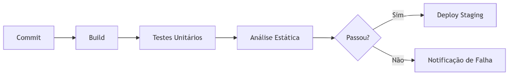
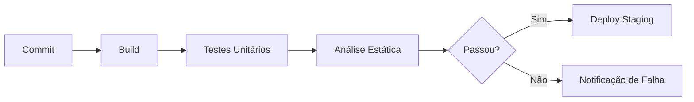
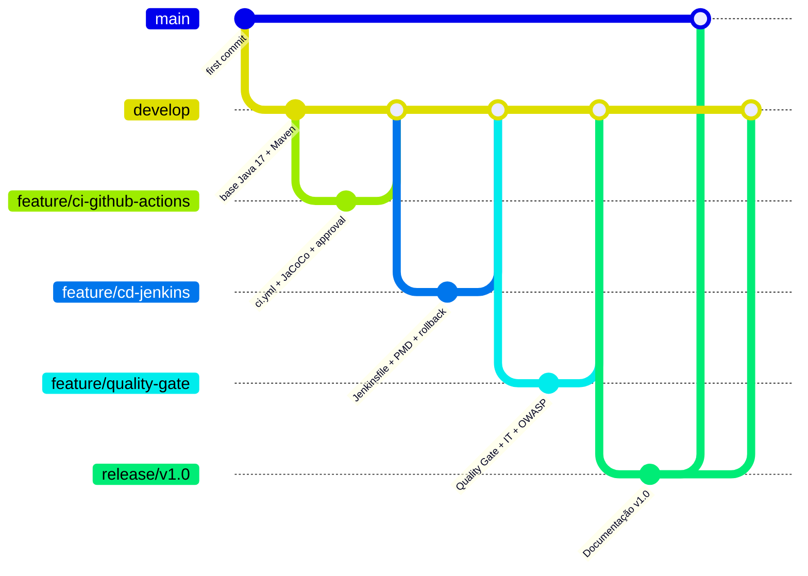

# aula10

Projeto em **Java 17 + Maven** referente à **Aula 10 - Integração Contínua (CI/CD) com Automação de Qualidade**, contemplando pipelines completos no **GitHub Actions** e **Jenkins**, análise estática com **Checkstyle** e **PMD**, cobertura de código e bloqueio por **Quality Gate (JaCoCo & SonarQube)**, testes unitários e de integração em paralelo e verificação de segurança **OWASP Dependency-Check**.

---

## 1. Pipeline de Qualidade Ideal





---

## 2. Fluxo Git Executado



---

## 3. Atividades Implementadas

### Atividade 1: Pipeline CI com GitHub Actions (`.github/workflows/ci.yml`)
- Configuração de JDK 17 (`temurin`) com cache Maven
- Build (`mvn clean package`), Testes Unitários (`mvn test`) e Checkstyle (`mvn checkstyle:check` com `continue-on-error: false`)
- **Exercício 1**: Geração e publicação automática do relatório de cobertura **JaCoCo** (`mvn jacoco:report` + `actions/upload-artifact@v4`)
- **Exercício 2**: Estágio de `deploy-staging` configurado com `environment: staging` para exigir **approval manual** antes do deploy
- Integração com **SonarQube Scan** (`SonarSource/sonarqube-scan-action@master`)

### Atividade 2: Pipeline CD com Jenkins (`Jenkinsfile`)
- Estágios declarativos de `Build`, `Test` (publicação de relatórios JUnit `target/surefire-reports/**/*.xml`), `Quality Gate` e `Deploy to Staging` (`docker build` + `kubectl apply -f k8s/deployment.yaml` na branch `main`)
- **Exercício 1**: Estágio dedicado de análise estática **PMD** (`stage('PMD Analysis')` executando `mvn pmd:check` com `pmd-ruleset.xml`)
- **Exercício 2**: **Rollback automático** em caso de falha no deploy (`kubectl rollout undo deployment/myapp` no bloco `post { failure }` do estágio de deploy) e notificação de falha no Slack (`#alerts`)

### Atividade 3: Automação de Qualidade (`.github/workflows/quality-gate.yml` e `sonar-project.properties`)
- Bloqueio automático de PRs com `-Dsonar.qualitygate.wait=true` e `jacoco:check`
- Regras configuradas e validadas em `QualityGateService`:
  - Cobertura mínima: **80%** (SonarQube) e **> 85%** (Desafio Integrado)
  - **Zero** bugs críticos
  - Dívida técnica (**Tech Debt**) **< 1h** (60 minutos)

### Desafio Integrado
- Jobs em paralelo no GitHub Actions (`unit-tests` e `integration-tests` com `mvn verify -Pintegration-tests`)
- Deploy condicionado à aprovação de todos os testes, cobertura > 85% e zero vulnerabilidades no **OWASP Dependency-Check** (`-Psecurity-check`)

---

## 4. Como Executar Localmente

```bash
# Executar build, testes unitários, testes de integração, cobertura JaCoCo (> 85%), Checkstyle e PMD
mvn clean verify checkstyle:check pmd:check -Pintegration-tests

# Executar verificação de vulnerabilidades OWASP Dependency-Check
mvn dependency-check:check -Psecurity-check
```
